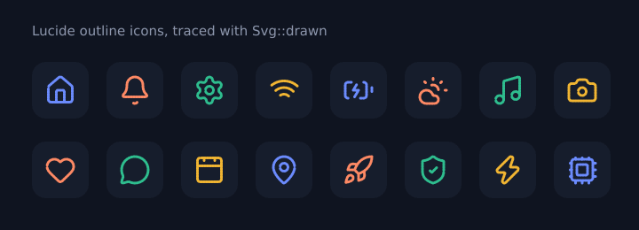

<div align="center">

# weaver-icons

### 4,400 icons for Rust, ready to draw or to animate.

The complete [Lucide](https://lucide.dev) outline set and the filled
[Material Icons](https://fonts.google.com/icons) set, with search, SVG
output, renderer-ready path commands and a draw-on effect.

</div>

<p align="center">
  
</p>
<p align="center"><sub>Every frame comes from <code>icon.svg().drawn(progress)</code>. Regenerate with the command at the bottom.</sub></p>

## Quick start

```toml
[dependencies]
weaver-icons = { git = "https://github.com/maxmaster55/weaver-icons" }
```

```rust
let icon = weaver_icons::get("house").unwrap();

let svg = icon.svg().size(32.0).color("#6c8cff").to_string();
std::fs::write("house.svg", svg).unwrap();
```

## Find icons

```rust
use weaver_icons::{get, search, IconSet};

get("bell");                 // Lucide first, then Material
get("material:home");        // pick the set explicitly
IconSet::Lucide.icons();     // iterate a whole set (sorted by name)

for icon in search("battery") {   // exact name, then name contains, then tags
    println!("{} ({:?})", icon.name(), icon.set());
}
```

| Set | Icons | Style | License |
| --- | --- | --- | --- |
| Lucide 1.70 | 2,322 | 2px rounded outlines | ISC |
| Material Icons 0.14 | 2,122 | Filled | Apache-2.0 |

Both are on by default. Turn one off to compile less:
`default-features = false, features = ["lucide"]`.

## Draw them anywhere

| Method | You get |
| --- | --- |
| `icon.svg()` | A builder: `.size(..)`, `.color(..)`, `.stroke_width(..)`, `.title(..)` for screen readers, `.drawn(0.0..=1.0)` |
| `icon.svg().group_at(x, y)` | A `<g>` to drop into a bigger SVG |
| `icon.commands()` | Absolute `MoveTo` / `LineTo` / `CubicTo` / `Close` on a 24×24 grid. Arcs, quadratics and relative commands are already converted. |
| `icon.commands_at(x, y, size)` | The same, scaled and placed |
| `icon.polylines(tolerance)` | Flattened point lists, for pixel or GPU renderers |
| `icon.paint()` | `Paint::Stroke { width: 2.0 }` or `Paint::Fill`, so you know how to draw it |
| `icon.length()` | Outline length, for your own trace animations |

`weaver_icons::path::parse` is the full SVG path parser behind all of this,
and you can use it for any path data.

## Draw-on animation

`svg().drawn(p)` traces an icon from 0 to 1. Outline icons draw along
their strokes; filled icons trace their outline and then fade the fill in.
Drive `p` from any animation source, such as a spring from the
[Weave motion engine](https://github.com/maxmaster55/weave-motion).

## Part of Weaver

`weaver-icons` is one of the [Weaver](https://github.com/maxmaster55) libraries.
[weaver-genui](https://github.com/maxmaster55/weaver_ui) uses it to check
and draw `icon` nodes by name, but it depends on none of them.

## Updating the icon sets

```sh
npm pack lucide-static @material-design-icons/svg
mkdir lucide material
tar xzf lucide-static-*.tgz -C lucide
tar xzf material-design-icons-svg-*.tgz -C material
python3 tools/generate.py lucide/package material/package
```

## Regenerate the animation

```sh
cargo run --example readme -- /tmp/frames
convert -delay 3 -loop 0 /tmp/frames/*.svg -layers Optimize docs/draw-on.gif
```

## License

The code is MIT or Apache-2.0, at your option. The icons keep their own
licenses: Lucide is ISC ([licenses/LUCIDE-ISC.txt](licenses/LUCIDE-ISC.txt)) and
Material Icons is Apache-2.0 ([licenses/MATERIAL-APACHE-2.0.txt](licenses/MATERIAL-APACHE-2.0.txt)).
